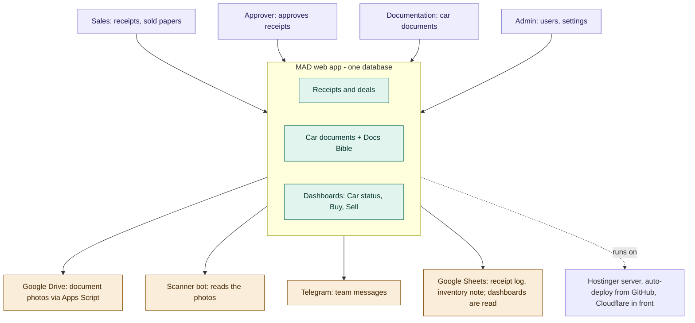
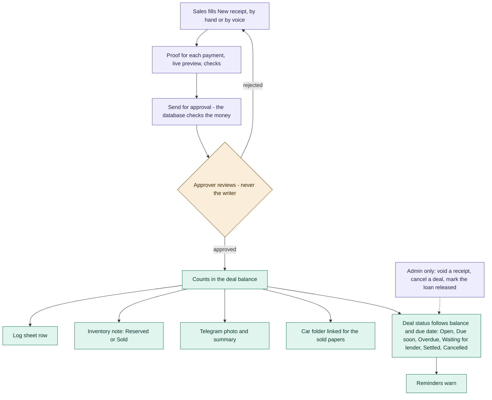
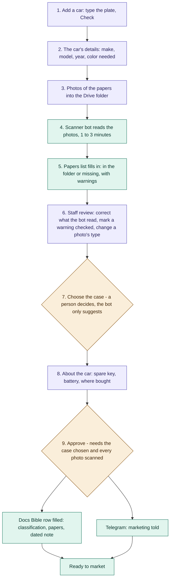
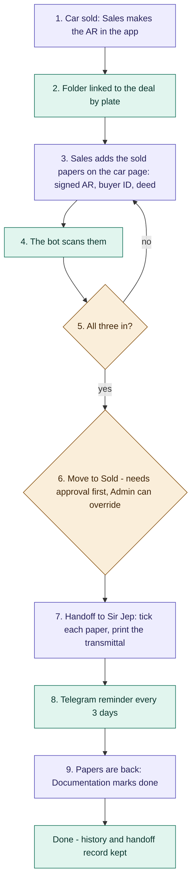
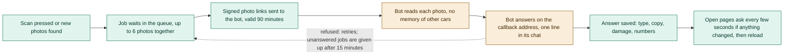
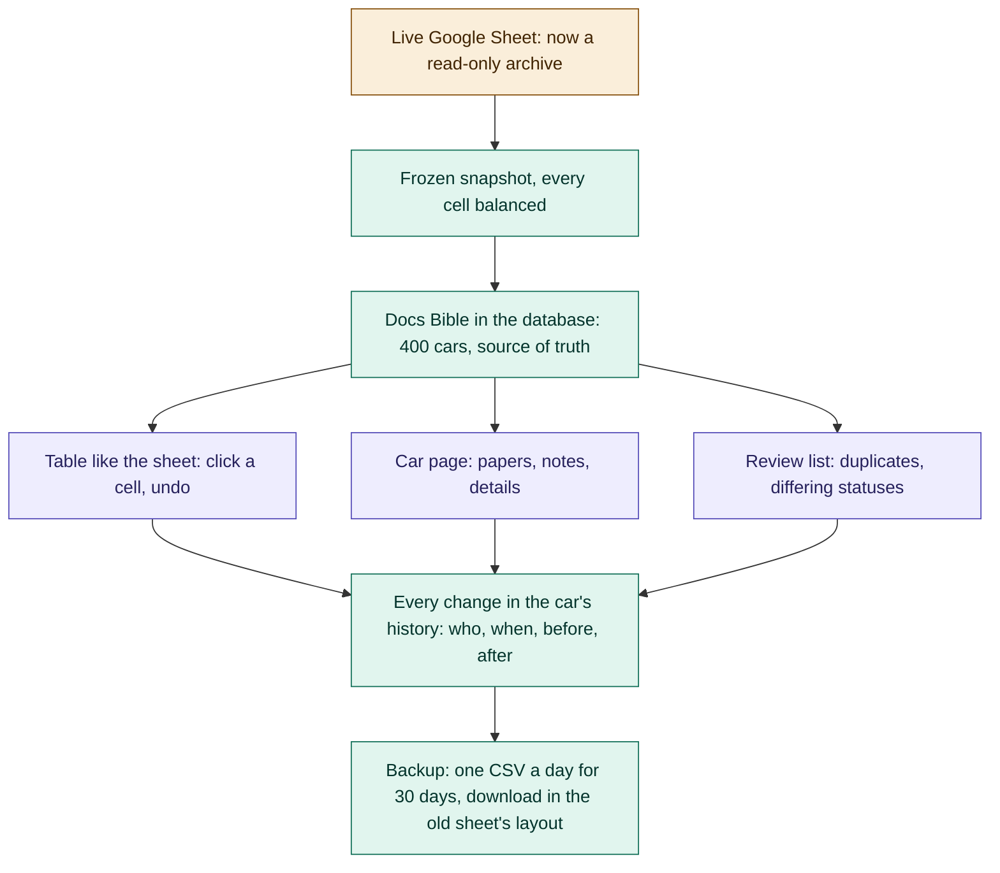

# Workflows of the MAD app

Flowcharts of every workflow, as they are today and as they are planned. They are Mermaid charts: GitHub and most editors draw them. Updated 18 Nov 2026.

Legend: **purple = a person does it, teal = the app does it, amber = a decision or an outside service**.

## 1. The big picture

## 2. Receipt and deal (money)

## 3. Documents IN: a new car to approval

Photos can be added at any time. The car page looks at the Drive folder every minute: photos taken out of Drive leave the page, and new ones are scanned.

## 4. Documents OUT: sold papers to handoff

Sales see the whole car page (photos, what the bot read, the papers, the Docs Bible row) with no button except Sold papers.

## 5. How a scan runs and how the page stays up to date

## 6. The Docs Bible data

Who edits: Documentation the papers and notes, Admin everything, Sales and Approver only look.

## 7. Status

**Working now:** receipts and approvals, voice entry, reminders and deal status, Buy and Sell dashboards, Car status, receipt log and inventory note, Telegram, the Docs Bible table and review list, the scanner bot and its queue, the daily CSV backup, roles and per-person access, auto-deploy, the transmittal print, folders linked to the live Drive.

**Being tested:** Add a car (details and photos), the Papers part and live updates, folder checks every minute, sold papers on the car page, Sales seeing photos with no buttons. Not yet tested: Move to Sold, handoff with the 3-day reminders, papers are back.

**Planned, not built:** stencil as a document (scan, checklist, column), receipt to Drive as a button for Documentation only (it no longer happens by itself), a help page ("where did my sheet column go?") and a first-visit tour, table paste / arrow keys / phone cards, retiring the old sheet-editor bot settings, the cut-over (the old sheet becomes read only), scanning the 367 photos still waiting.

Not changed by this project: the receipt log sheet and the inventory note.
